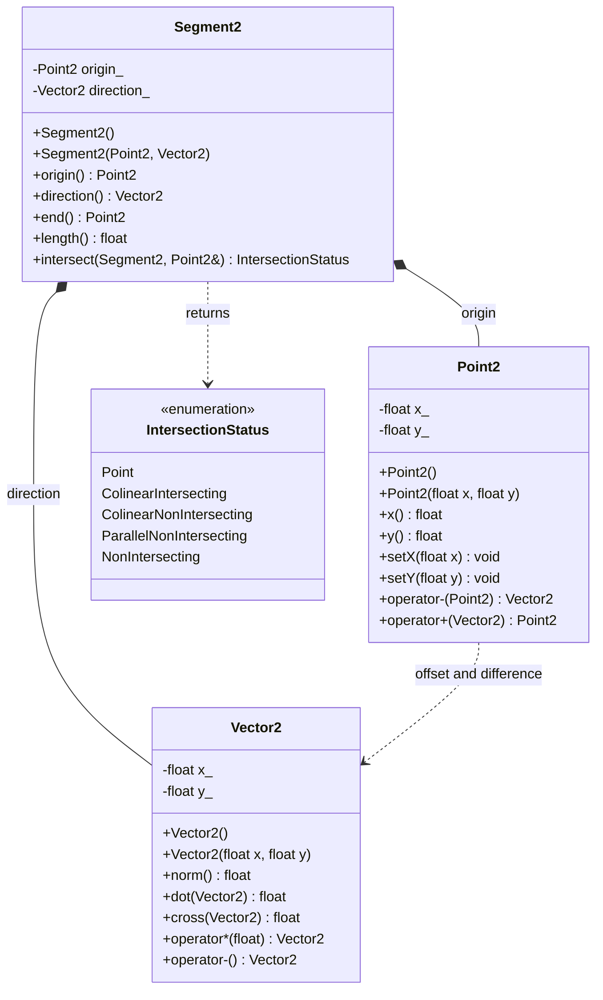

# 2D segments in C++

This is an object-oriented C++17 port of the files in `L1-Segments2D-C.zip`.
Build it from this directory with `make`, or compile `main.cpp`, `Point2.cpp`,
`Vector2.cpp`, and `Segment2.cpp` with a C++17 compiler. The example `main`
preserves the original program's behavior: it constructs the same two points,
vectors, and segments, prints nothing, and exits successfully.

## Class diagram

## Mapping from C to C++

| Original C | C++ implementation |
| --- | --- |
| `Point2` struct and `Point2_init*` | `Point2` class and overloaded constructors |
| `Point2_getX/Y`, `Point2_setX/Y` | `x()`, `y()`, `setX()`, `setY()` with private coordinates |
| `Point2_print` | `operator<<` for `std::ostream` |
| `Point2_sub(r, p)` | `r - p`, returning a `Vector2` |
| `Point2_add(p, r)` | `p + r`, returning a `Point2` |
| `Vector2` struct and `Vector2_init` | `Vector2` class and constructors |
| `Vector2_norm`, `dot`, `cross`, `dot_scalar`, `negate` | `norm()`, `dot()`, `cross()`, `operator*`, unary `operator-` |
| `Segment2` struct and `Segment2_init` | `Segment2` class with a value constructor |
| `Segment2_getOrigin/Direction`, `length` | `origin()`, `direction()`, `length()`, and `end()` |
| `IntersectionStatus` C enum | Scoped `enum class IntersectionStatus` |
| `Segment2_intersect(s, r, p)` | `s.intersect(r, p)` |

